<div align="center">

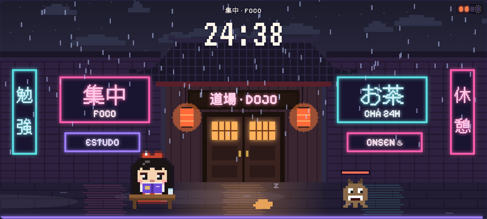

# Dojo do Foco 道場

**Pomodoro de estudos em pixel art japonesa.**
Sua personagem estuda junto com você, luta contra yōkais durante o foco,<br>
toma chá na pausa curta e entra no onsen na pausa longa.


### [▶ Jogar agora: dojo-do-foco.netlify.app](https://dojo-do-foco.netlify.app)

[Como rodar](#-como-rodar) · [O jogo](#-o-jogo) · [Cenários](#-cenários) · [Personagens](#-personagens) · [Obsidian](#-salvamento-no-obsidian) · [Publicar](#-publicar-no-netlify)

</div>

<br>

<div align="center">
  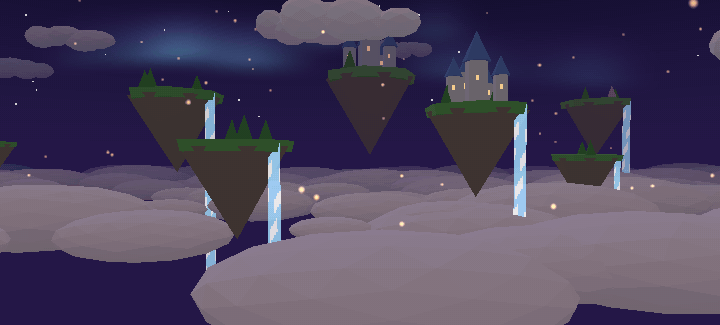
</div>

<br>

## 🚀 Como rodar

Precisa do [Node.js](https://nodejs.org) 18 ou mais novo. Não há nada para instalar.

```bash
npm start
```

Abra **<http://localhost:4321>**. No VS Code também dá para usar **Executar e depurar → Dojo do Foco (servidor local)**, que já abre o navegador.

> Abrir o `index.html` direto também funciona, mas aí o progresso fica salvo só no navegador. Pelo servidor ele vai para o Obsidian.

## 🎮 O jogo


| | |
| --- | --- |
| ⏱️ **Pomodoro completo** | Foco, pausa curta e pausa longa a cada ciclo, com o chefe no último pomodoro |
| ✍️ **Plano e revisão** | Antes de cada batalha você escreve o que vai fazer. Depois, conta se conseguiu tudo, parte ou se travou |
| 🌗 **Hora e clima de verdade** | A cena escurece com o dia, os neons acendem à noite e o clima da sua cidade aparece, pela [Open-Meteo](https://open-meteo.com): chuva, neve, neblina, tempestade |
| 🧠 **Feito para TDAH** | Uma ação de cada vez, botão "Só 5 minutos", aviso 1 minuto antes do fim, modo foco e nenhuma bronca |
| 🎵 **Música nas pausas** | Uma música lo-fi aconchegante, composta no próprio jogo, começa com a pausa e para quando ela acaba. Mais lenta no onsen |
| 📜 **Pergaminho de distrações** | Pensou em outra coisa? Anota em um toque e volta. Você resolve na pausa |
| 🏆 **RPG** | XP, nível, títulos de Aprendiz a Shōgun, energia, moedas ryō, conquistas e uma loja de recompensas que você mesmo cria |

### Durante o foco, a pausa e o onsen

A personagem não fica parada. Ela estuda conforme o tipo de missão: lê um livro, escreve com pincel, usa o ábaco, programa no notebook ou revisa cartões. A cada 40 segundos corre até o yōkai e ataca. Na casa de chá o mestre serve o chá e ela bebe. No onsen ela entra devagar na água quente.

## 🏯 Cenários

<table>
  <tr>
    <td width="50%">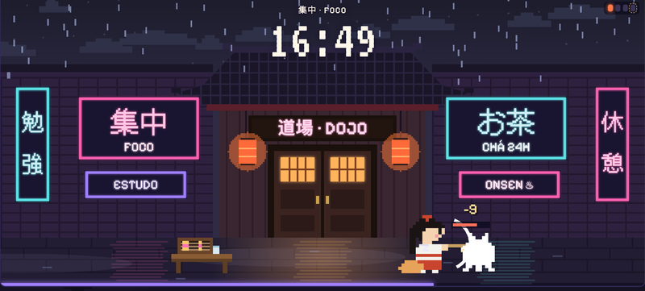<br><b>Dojo da cidade</b> · letreiros de neon e lanternas</td>
    <td width="50%">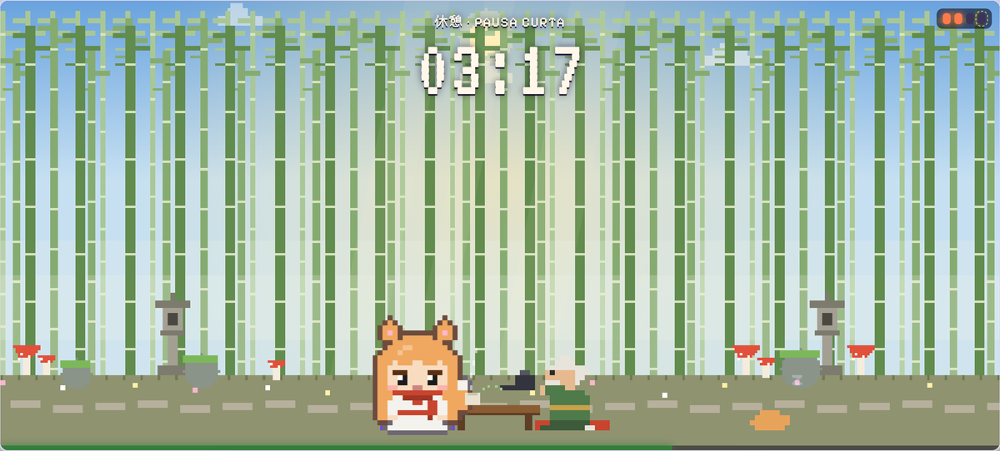<br><b>Bosque de bambu</b> · lanternas de pedra e vaga-lumes à noite</td>
  </tr>
  <tr>
    <td><br><b>Templo na montanha</b> · torii, escadaria e o monte Fuji</td>
    <td>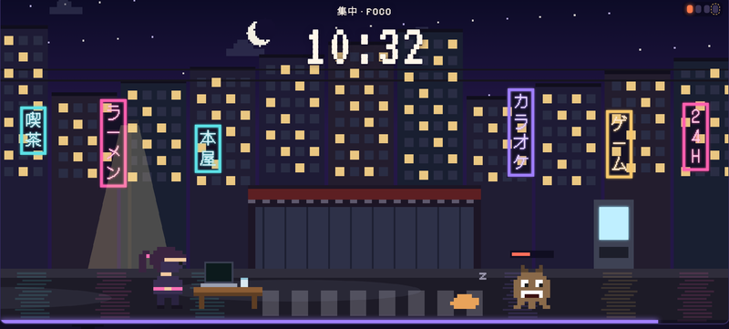<br><b>Rua de Tóquio</b> · placas de neon, máquina de bebidas e poste</td>
  </tr>
  <tr>
    <td><br><b>Jardim de sakura</b> · pétalas caindo, lago com carpas e ponte</td>
    <td><br><b>Onsen com neve</b> · a pausa longa, em qualquer cenário</td>
  </tr>
</table>

<div align="center">
  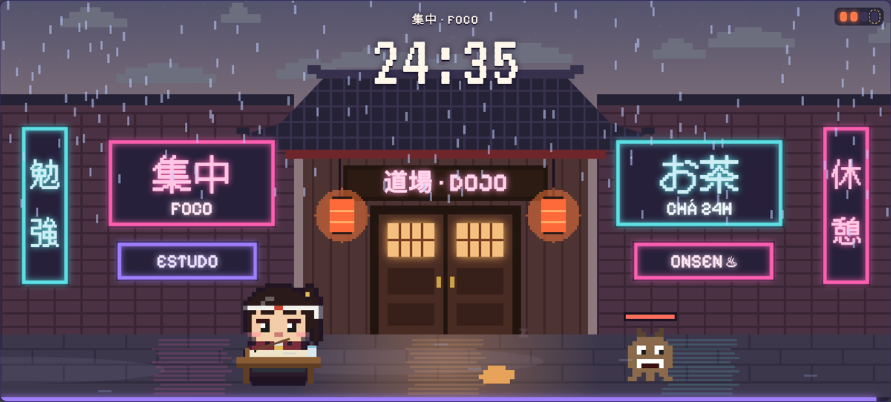<br>
  <sub>O clima muda tudo: aqui, uma tempestade no fim da tarde.</sub>
</div>

## 🥷 Personagens


Crie quantas personagens quiser, do zero ou a partir de **14 modelos prontos**, e mude tudo nelas:

- **Identidade:** nome, título, classe, arma, habilidade, personalidade, frase de efeito e história
- **Aparência:** penteado, traje, acessório (laço, kanzashi, chapéu kasa, orelhas de raposa, chifres de oni...) e rosto
- **Cores:** pele, cabelo, olhos, roupa, detalhes, arma e duas cores livres
- **Desenho à mão:** a cabeça e o tronco pintados pixel por pixel
- **Especificações:** 24 pontos para distribuir entre força, agilidade, mente e espírito

<details>
<summary><b>As 12 classes e suas habilidades</b></summary>

| Classe | Arma | Habilidade |
| --- | --- | --- |
| Samurai 侍 | Katana | +10% de XP em cada pomodoro |
| Ninja 忍 | Kunai | +5 ryō por yōkai derrotado |
| Miko 巫 | Gohei | Pausas recuperam +10 de energia |
| Monge 僧 | Cajado | Missões concluídas dão +20 XP |
| Onna-bugeisha 女武 | Naginata | Chefes dão +25% de XP |
| Kunoichi くノ一 | Kunai | +3 ryō por pausa completa |
| Arqueira 弓 | Arco e flecha | Cada passo marcado dá +2 XP extra |
| Onmyōji 陰陽 | Talismãs ofuda | Revisões dão +5 XP extra |
| Ferreira 鍛 | Martelo | +20 ryō ao bater a meta diária |
| Kitsune 狐 | Leque | "Só 5 minutos" dá o dobro de XP |
| Yamabushi 山伏 | Cajado | A pausa longa recupera toda a energia |
| Rōnin 浪人 | Katana | +5% de XP por dia seguido, até 25% |

A arma e a habilidade podem ser trocadas no editor, independente da classe.

</details>

## 📋 Missões, resumo e ajustes

<table>
  <tr>
    <td width="50%">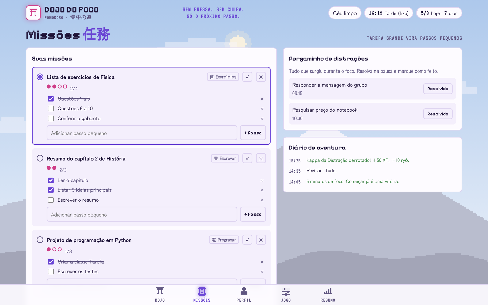</td>
    <td width="50%">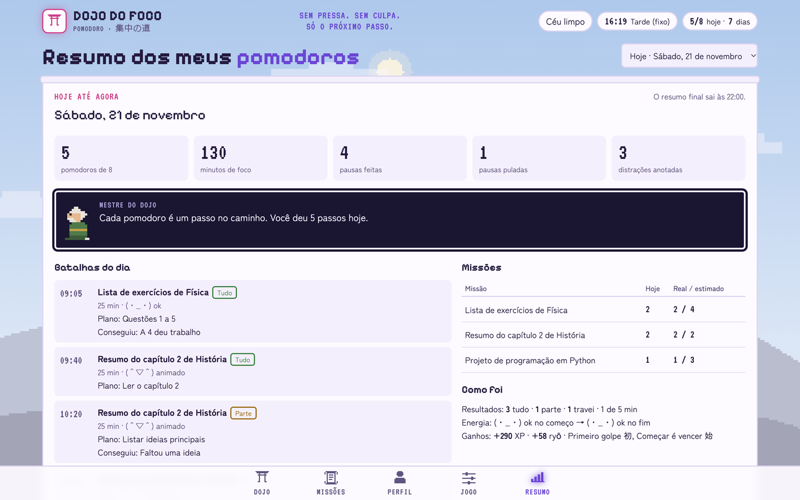</td>
  </tr>
  <tr>
    <td><b>Missões</b> · cada tarefa vira passos pequenos, com a estimativa de pomodoros e o que você realmente gastou</td>
    <td><b>Resumo do dia</b> · batalhas com plano e resultado, melhor horário, energia e sugestões para amanhã</td>
  </tr>
</table>

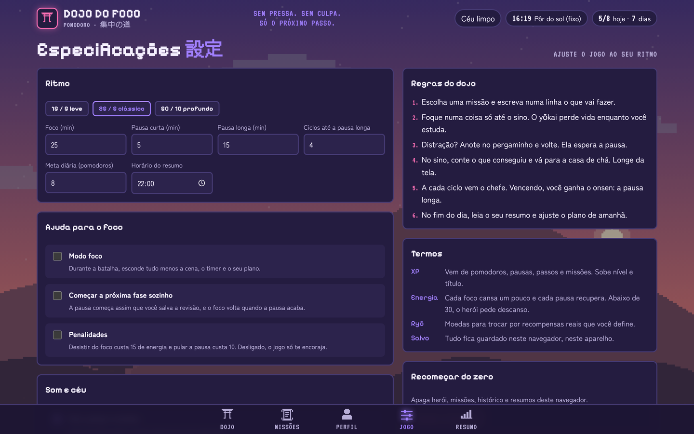

Na aba **Jogo** você ajusta os tempos (15/5, 25/5, 50/10 ou do seu jeito), a meta diária, o modo foco, as penalidades, o som, o céu, o cenário e o clima.

### No celular

<p align="center">
  
  &nbsp;&nbsp;
  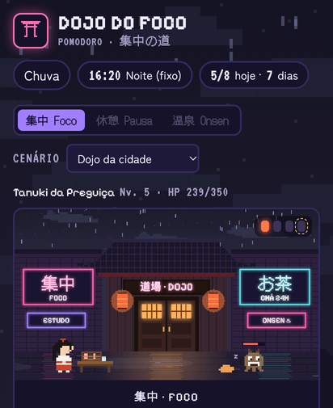
</p>

## 📁 Salvamento no Obsidian

Rodando pelo servidor local, o jogo salva tudo num cofre do Obsidian **sempre que algo muda e quando você fecha a aba**. Ao abrir de novo, ele carrega o progresso de lá.

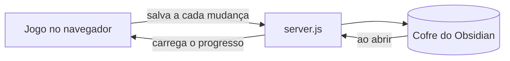

Por padrão o cofre fica em `~/Documents/Obsidian/Dojo do Foco`. No Obsidian, use **Abrir pasta como cofre** e escolha essa pasta. O jogo cria:

| Arquivo | O que tem |
| --- | --- |
| `Dojo do Foco.md` | Painel com a personagem ativa, nível, o dia de hoje e links |
| `Resumos/AAAA-MM-DD.md` | Resumo de cada dia: batalhas, plano e resultado, missões, distrações, energia |
| `Missões.md` | Missões e passos em checklist |
| `Pergaminho de distrações.md` | O que você anotou para resolver depois |
| `Personagens/<nome>.md` | Ficha de cada personagem |
| `_dados/dojo-save.json` | O estado completo do jogo, lido ao abrir |

As notas são geradas pelo jogo, então o que você editar nelas é substituído no próximo salvamento. Escreva suas próprias anotações em outras notas do cofre.

<details>
<summary><b>Usar outra pasta ou outra porta</b></summary>

Crie um `dojo.config.json` na raiz do projeto (ele não vai para o Git):

```json
{ "vaultPath": "~/Documents/MeuCofre/Dojo do Foco", "port": 4321 }
```

Ou use variáveis de ambiente:

```bash
DOJO_VAULT=/caminho/do/cofre PORT=4321 npm start
```

</details>

## 🌐 Publicar no Netlify

O projeto já vem pronto para o [Netlify](https://www.netlify.com), que é gratuito e funciona com repositório privado. O `netlify.toml` diz tudo o que ele precisa: roda `npm run build` e publica a pasta `dist/`.

1. Entre em <https://app.netlify.com> com a sua conta do GitHub.
2. Clique em **Add new site** (ou **Add new project**) → **Import an existing project** → **GitHub** e autorize o acesso ao repositório `dojo-do-foco`.
3. Escolha o repositório. O comando de build e a pasta de publicação já aparecem preenchidos pelo `netlify.toml`. Clique em **Deploy**.
4. Nas configurações do site, troque o nome para ganhar um endereço como `dojo-do-foco.netlify.app`.

Depois disso, cada `git push` publica uma versão nova sozinho.

| | No site publicado | Rodando `npm start` |
| --- | --- | --- |
| Onde o progresso fica | No navegador de cada aparelho | No cofre do Obsidian |
| Clima | Automático, pela cidade ou pela localização do aparelho | Automático, pela cidade ou pela localização |
| Onde abre | Em qualquer aparelho, celular incluído | Só no computador onde o servidor está rodando |

Para conferir o site antes de publicar:

```bash
npm run build
```

O resultado fica em `dist/index.html`.

## 🧱 Estrutura

```
index.html        o jogo inteiro: HTML, CSS e JavaScript, com a pixel art desenhada em canvas
server.js         servidor local e gravação no cofre do Obsidian
lib/page.js       monta o documento completo (viewport, ícone) a partir do index.html
scripts/build.js  gera a versão estática em dist/ para o Netlify
netlify.toml      configuração de publicação no Netlify
package.json      scripts npm start e npm run build
docs/             capturas de tela e GIF deste README
.vscode/          configuração para rodar pelo VS Code
```

<div align="center">
<sub>As capturas usam dados de exemplo. Sem pressa. Sem culpa. Só o próximo passo.</sub>
</div>
