# Opções de visual dos modelos

Gerado por `node scripts/opcoes-personagens.js` a partir do código do `index.html`. Não edite à mão.

Cada imagem mostra o sprite **antes** (de lado) e as três opções chibi **de frente**. A opção **A** (com borda rosa) é o visual do modelo no jogo. As opções ficam em `PRESET_OPTS`, no `index.html`.

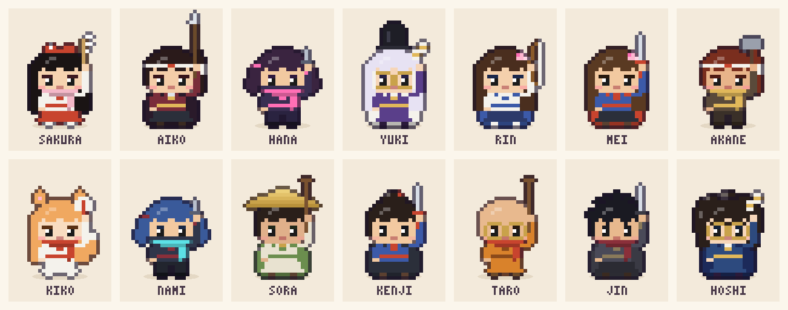

| Modelo | Classe | Antes · A · B · C |
| --- | --- | --- |
| Sakura | miko | 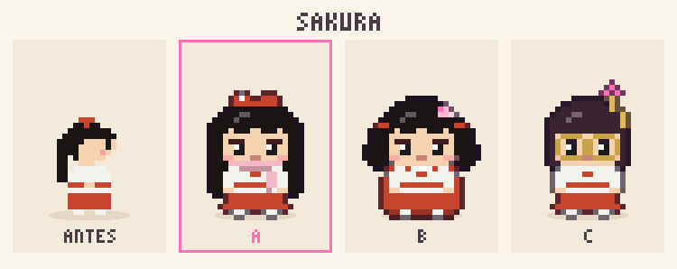 |
| Aiko | onna | 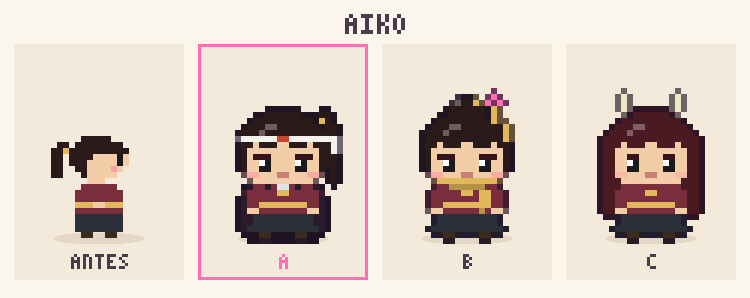 |
| Hana | kunoichi | 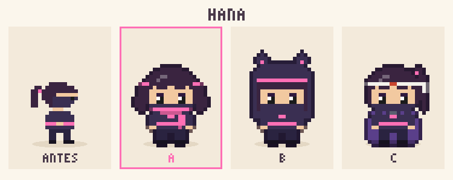 |
| Yuki | onmyoji | 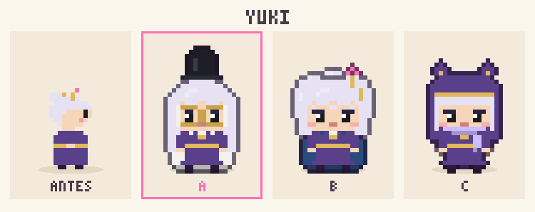 |
| Rin | kyudo | 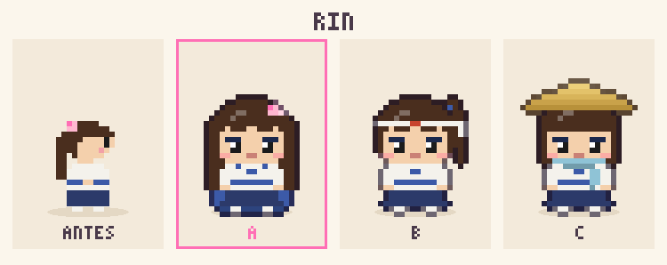 |
| Mei | samurai | 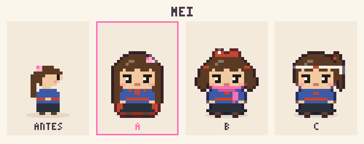 |
| Akane | ferreira | 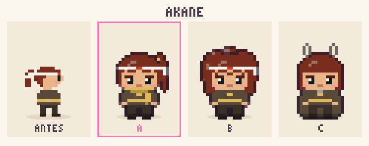 |
| Kiko | kitsune | 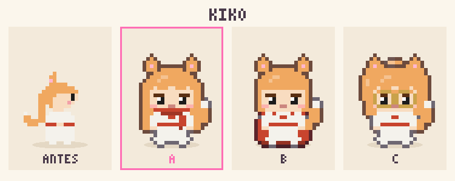 |
| Nami | ninja | 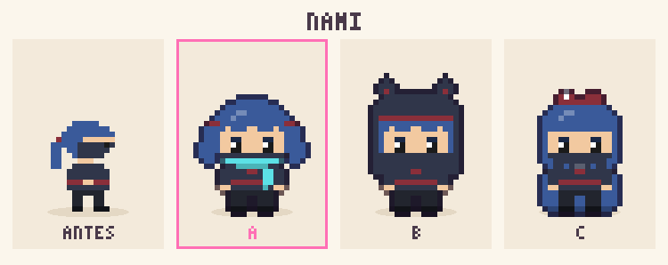 |
| Sora | yamabushi | 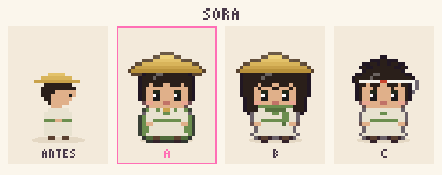 |
| Kenji | samurai | 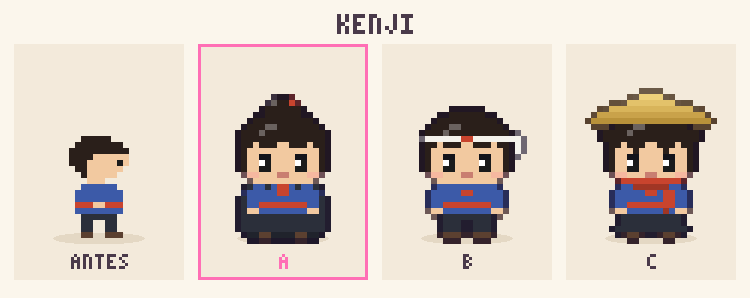 |
| Taro | monge | 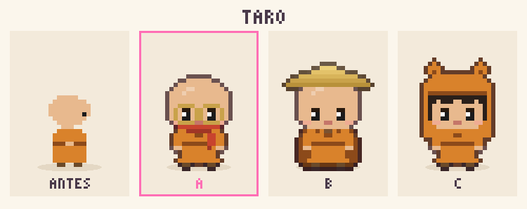 |
| Jin | ronin | 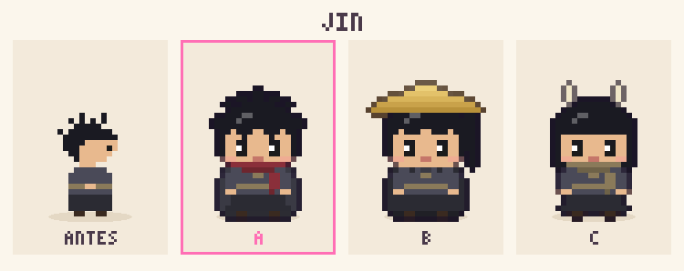 |
| Hoshi | onmyoji | 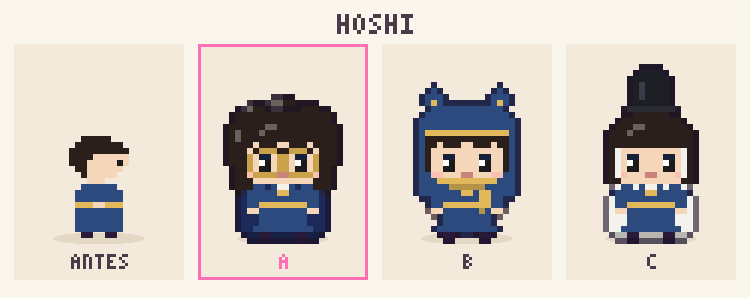 |
